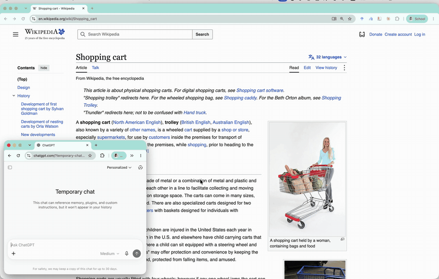

<p align="center"></p>

<h1 align="center">fairy cursor</h1>

<p align="center">a little glass bead that follows your cursor and carries your screenshots.</p>

<p align="center"></p>

## install

download the latest `fairy-cursor.zip` from [releases](https://github.com/Rrrima/fairy-cursor/releases), move the app to `/Applications` and open it. it lives in the menu bar.

needs macos 26.

## use

| | |
| --- | --- |
| `⌘ ⇧ 3` `⌘ ⇧ 4` `⌘ ⇧ 5` | take a screenshot. the fairy picks it up |
| double-click a text box | paste it there |
| double-click the desktop or a finder window | save it as a png |
| shake | let the top one go. keep shaking to drop them all |
| hold `⌥`, then click | start a sticky note |

dropped one by accident? menu bar → **restore last screenshot**.

## permissions

| | why |
| --- | --- |
| accessibility | follow the cursor, see what's under it, paste |
| screen recording | capture the screenshot you just took |

nothing leaves your mac.

## build

```sh
git clone https://github.com/Rrrima/fairy-cursor && cd fairy-cursor
scripts/bundle.sh --run     # builds build/Fairy Cursor.app and opens it
swift test
```

logs: `FAIRY_DEBUG=1 "build/Fairy Cursor.app/Contents/MacOS/FairyCursor"`

screenshot and cursor detection come from [ausm](https://github.com/foundation-interface/AUSM), compiled into the app.
