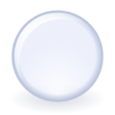

# <picture><source media="(prefers-color-scheme: dark)" srcset="assets/icon-dark.png"></picture> fairy cursor

a little fairy that follows your cursor and carries your screenshots: take one, then double-click where it should go.

needs macos 26.

## download

grab `fairy-cursor.zip` from the [latest release](https://github.com/Rrrima/fairy-cursor/releases/latest), unzip it and drag **fairy cursor** into `/Applications`.

the first time you open it, macos may say it can't check the app. open **system settings → privacy & security**, scroll down and click **open anyway**.

## build from source

you need xcode 26, or just its command line tools (`xcode-select --install`).

```sh
git clone https://github.com/Rrrima/fairy-cursor && cd fairy-cursor
scripts/bundle.sh
```

that builds `build/Fairy Cursor.app` (the first build takes a minute or two). to install it:

```sh
cp -R "build/Fairy Cursor.app" /Applications/
```

## run

```sh
open "/Applications/Fairy Cursor.app"
```

it lives in the menu bar; there's no dock icon. then turn it on in **system settings → privacy & security**:

1. **accessibility** → fairy cursor
2. **screen recording** → fairy cursor
3. quit fairy from the menu bar and open it again

after you rebuild, macos may forget these. turn them off and on again.

## use

- `⌘ ⇧ 3` `⌘ ⇧ 4` `⌘ ⇧ 5` take a screenshot. the fairy picks it up
- double-click a text box to paste it
- double-click the desktop or a finder window to save it as a png
- shake to let the top one go. keep shaking to drop them all
- hold `⌥` on empty space, then click, to start a sticky note

dropped one by accident? menu bar → restore last screenshot. your notes are under menu bar → recent notes.

## record your screen

- `⌘ ⇧ 6` starts recording the screen your cursor is on. press it again to stop
- while recording, hold `⌥` and scroll to zoom in and out
- hold `⌥` and move the cursor to move the zoomed view with it. let go and the view stays put
- the cursor gets bigger while you record, and goes back when you stop
- the recording is saved next to your screenshots and shown in finder

the blue outline shows what's being recorded; it isn't in the video. on a mac with a touch bar, `⌘ ⇧ 6` normally screenshots the touch bar; the fairy uses it for recording instead.

## settings

menu bar → settings…

- **capabilities**: screenshots, notes and screen recording each switch on and off on their own. switch one off and it lets go of everything it took over (screenshots go back to macos, `⌘ ⇧ 6` back to the system)
- **keep every screenshot**: off by default, so a screenshot is only saved where you drop it and shaking throws it away. turn it on and every screenshot is saved to a folder you pick as you take it, and shaking just lets go
- **notes folder**: each note is a markdown file there (`~/Documents/Fairy Notes` by default), so you can open, edit and sync them like any other file
- **captures folder**: where kept screenshots and recordings go (where macos saved screenshots, by default)

## permissions

- accessibility: follow the cursor, see what's under it, paste
- screen recording: capture the screenshot you just took

nothing leaves your mac.

## change how it works

the fairy doesn't take screenshots itself. it notices yours, so to use different screenshot keys, change them in **system settings → keyboard → keyboard shortcuts → screenshots** and the fairy follows.

everything that watches what you do comes from [ausm](https://github.com/foundation-interface/ausm), an open toolkit for reacting to activity on your mac. if you want the fairy to react to something else, start there:

- **screenshots**: `ScreenshotMonitorKit` ([`device-macos/screenshot-detector`](https://github.com/foundation-interface/ausm/tree/main/device-macos/screenshot-detector)) works out when a `⌘ ⇧ 3/4/5` screenshot is taken and recaptures it
- **cursor and clicks**: `CursorMonitorKit` ([`device-macos/cursor-plus-plus`](https://github.com/foundation-interface/ausm/tree/main/device-macos/cursor-plus-plus)) reports moves and double-clicks, and what's under the cursor

the fairy's own gestures live in this repo:

- shake: `sources/core/ShakeDetector.swift` (how far, how fast, how many times)
- what a double-click does where: `sources/core/DropPolicy.swift`, `sources/core/PastePolicy.swift`
- hold `⌥` for a note: `sources/capabilities/notes/NoteSummoner.swift`
- the recording shortcut and `⌥` + scroll: `sources/capabilities/recording/RecordingInput.swift`
- how ausm is wired in: `ScreenshotsCapability.swift` and `startCursorMonitor()` in `sources/app/AppDelegate.swift`

## add a capability

the fairy itself only follows the cursor, carries screenshots and drops them. everything else it does is a capability, and each one is its own module:

```
sources/
  kit/            FairyKit: the Capability protocol and the FairyHost it talks to
  capabilities/
    screenshots/  ⌘⇧3/4/5 → the fairy carries the shot
    notes/        hold ⌥ for a note
    recording/    ⌘⇧6 screen recording
  app/            the host: the fairy, the menu, settings, and the list of capabilities
  core/           pure logic, unit-tested
```

a capability imports only `FairyKit`. it says who it is and what it needs, starts in `activate`, cleans up in `deactivate`, and can add menu items and settings rows:

```swift
import AppKit
import FairyKit

@MainActor
public final class HelloCapability: Capability {
    public static let manifest = CapabilityManifest(
        id: "com.you.hello", name: "Hello", summary: "says hello from the menu.")

    private weak var host: FairyHost?
    public init() {}

    public func activate(host: FairyHost) { self.host = host }
    public func deactivate() { host = nil }

    public func menuItems() -> [NSMenuItem] {
        [ActionMenuItem("Say Hello") { NSSound.beep() }]
    }
}
```

through `FairyHost` it can hand the fairy a screenshot (`carry`), use what it's carrying (`carried`, `delivered`), keep other capabilities' gestures quiet while it has the screen (`setExclusive`), and find the captures folder. to try it, add a target for it in `Package.swift` and list it in `CapabilityRegistry.builtIn` (`sources/app/CapabilityRegistry.swift`). it shows up in settings → capabilities.

capabilities are compiled in for now. installing one you downloaded, without rebuilding, is next.

## develop

```sh
scripts/bundle.sh --run   # rebuild and relaunch
swift test
```

to build against a local ausm checkout instead of the published one:

```sh
AUSM_ROOT=/path/to/ausm scripts/bundle.sh --run
```

to make a release zip (`build/fairy-cursor.zip`, apple silicon and intel):

```sh
scripts/bundle.sh --zip       # ad-hoc signed; people click "open anyway" the first time
scripts/bundle.sh --release   # developer id signed and notarized; see the top of the script
```

## license

mit. barlow is under the sil open font license (`resources/fonts/OFL.txt`).
